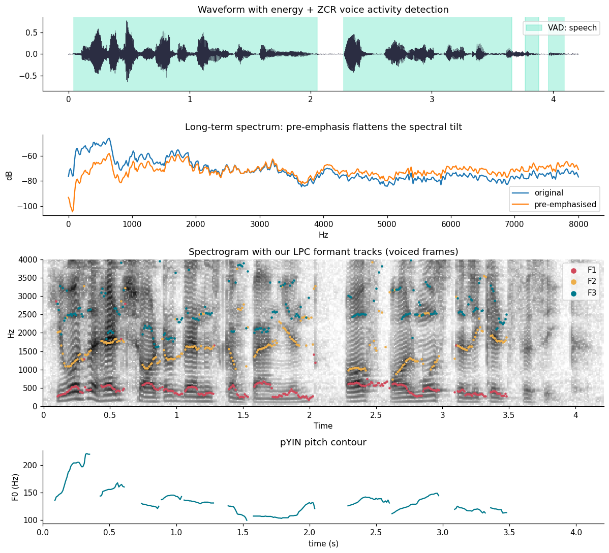
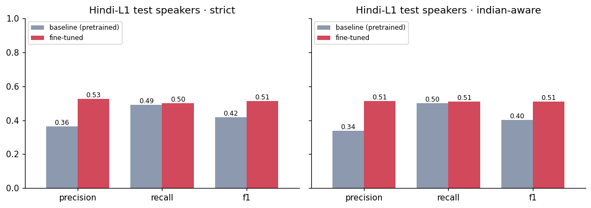
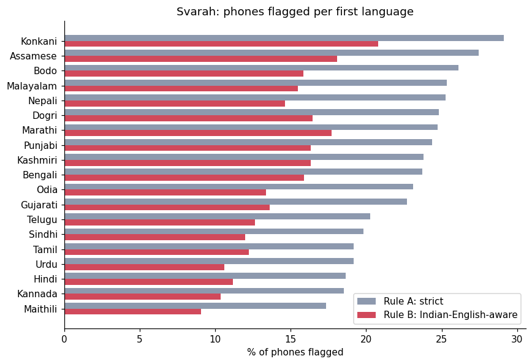

<div align="center">

# PhonoLens

**Hear what you actually said. Mispronunciation detection and articulatory feedback for Indian English speakers.**


</div>

A pronunciation coach for English learners whose first language is Indian. You read a sentence out loud, and PhonoLens tells you which sounds came out differently from what was expected, what it heard instead, and how to move your mouth to fix it. Every phone gets a score, every word gets a colour, and your vowels land on a chart next to where fluent Indian English speakers put theirs.

Most pronunciation tools quietly assume the goal is an American accent. That's the part I wanted to get right. An Indian speaker saying "face" with a pure /e/ instead of the American /eɪ/ isn't making a mistake, it's a standard Indian English realisation. So PhonoLens has two rules: a **strict** one that flags any difference from the dictionary, and an **Indian-English-aware** one that only flags a sound if it's genuinely off compared to what fluent Indian speakers produce. Then it checks whether that second rule actually judges speakers of 19 different Indian first languages more fairly. (Honest answer: it flags far less overall, but not more evenly. More on that below.)

Built for MAI522 Speech and Pattern Recognition (CIA-III, Team 23).

## What it does

- **Recognises what was actually said, phone by phone.** A wav2vec2 XLSR-53 phoneme recogniser, fine-tuned on non-native English to output a 39-phone set, decodes the audio into the sounds the speaker really produced rather than the ones they were meant to.
- **Finds and diagnoses mispronunciations.** The recognised phones are aligned against the canonical pronunciation (Levenshtein), so each error is reported as "expected /ʌ/, heard /ɪ/" rather than a vague "try again".
- **Scores every phone** with CTC likelihood-ratio GOP (goodness of pronunciation) features fed into a gradient-boosted regressor trained on speechocean762's expert phone scores.
- **Measures your vowels with classical DSP.** Pre-emphasis, energy and zero-crossing VAD, pYIN pitch, and a pitch-adaptive LPC formant tracker written from scratch and validated against Praat. Vowels are placed on an F1/F2 chart after Lobanov normalisation.
- **Compares you to Indian English, not American English.** Vowel targets, phone durations, and per-phone GOP thresholds come from fluent Indian English speech (IndicTTS, 13 first languages).
- **Gives articulatory tips** for each flagged sound: where the tongue goes, whether the lips round, how long to hold it, with a side-view mouth diagram of the target sound next to the sound you actually made.
- **Runs as a web app.** A FastAPI backend serves a custom web front end (plus the original Gradio UI at `/ui`). See [The web app](#the-web-app) below.

## How it works

```
                 audio + target sentence
                           │
            ┌──────────────┴──────────────┐
            ▼                             ▼
   ┌─────────────────┐          ┌──────────────────┐
   │ wav2vec2 (fine- │          │ classical DSP    │
   │ tuned, 39 phones│          │ pre-emphasis,    │
   │ + CTC blank)    │          │ VAD, pYIN, LPC   │
   └────────┬────────┘          └────────┬─────────┘
            │ log-probs                  │ F1/F2, F0, duration
            ▼                            │
   CTC forced alignment ─── phone spans ─┤
   + GOP features                        │
            │                            │
            └────────────┬───────────────┘
                         ▼
              ┌─────────────────────┐
              │ GBM phone scorer    │   trained on speechocean762
              └──────────┬──────────┘   expert scores
                         ▼
              ┌─────────────────────┐
              │ Rule A: strict      │
              │ Rule B: Indian-     │   IndicTTS norms + p10
              │ English-aware       │   GOP thresholds
              └──────────┬──────────┘
                         ▼
         per-phone flags, scores, tips, vowel chart
```

A few design choices that mattered:

- **Train on what was said, not what should have been said.** The recogniser's targets are the expert *annotated* pronunciations from L2-ARCTIC. Training on dictionary pronunciations would teach the model to "hear" every error as correct, which defeats the point.
- **Warm-started output head.** The new 40-class head (blank + 39 phones) is initialised from the pretrained model's matching espeak phone rows, so fine-tuning starts from the baseline instead of from random.
- **Speaker-independent splits.** Train on 15 L2-ARCTIC speakers (plus adult speechocean762 utterances rated fully correct), select on 5 dev speakers from other L1s, and test on the 4 Hindi-L1 speakers, who are never seen in training.

## Results

All numbers are on the **4 unseen Hindi-L1 speakers** (600 utterances) unless noted.

**Phone recognition and mispronunciation detection** (strict labels)

| Model | PER | Precision | Recall | F1 | False rejection | Diagnosis acc. |
|---|---|---|---|---|---|---|
| Pretrained wav2vec2 (no fine-tuning) | 0.231 | 0.364 | 0.492 | 0.419 | 0.137 | 0.628 |
| **PhonoLens fine-tuned** | **0.155** | **0.527** | **0.501** | **0.514** | **0.072** | **0.763** |

Fine-tuning cut phone error rate by a third and halved the number of correct sounds wrongly flagged as errors. Best checkpoint was epoch 9 of 12 by dev F1.

**Phone scorer** (speechocean762 test set, Pearson correlation with expert scores)

| Features | Test PCC | AUC (incorrect phones) |
|---|---|---|
| GOP only (linear) | 0.543 | 0.922 |
| Model features (GBM) | 0.677 | 0.948 |
| Model + classical formant features | 0.678 | 0.948 |

The classical vowel features barely move the needle once the model's own posteriors are in. Worth knowing.

**Rule A vs Rule B** (strict labels)

| Rule | Precision | Recall | F1 | False rejection | Flag rate |
|---|---|---|---|---|---|
| A: strict | 0.527 | 0.501 | 0.514 | 0.072 | 13.1% |
| B: Indian-English-aware (p10) | 0.506 | 0.164 | 0.247 | 0.025 | 4.4% |

Rule B is much gentler: it wrongly flags a correct sound a third as often, at the cost of catching fewer real errors. The threshold percentile is the knob between the two.

**Accent fairness on Svarah** (19 Indian first languages, flag rate per language group)

| Rule | Mean flag rate | Max / min ratio | Coeff. of variation |
|---|---|---|---|
| A: strict | 0.228 | 1.68 | 0.148 |
| B: Indian-English-aware | 0.144 | 2.30 | 0.213 |

This is the honest result: Rule B flags far fewer phones for everyone, but the spread *between* language groups gets wider, not narrower. Lower absolute burden, not yet more even.

**Formant tracker vs Praat** (40 utterances, ~9k voiced frames): median absolute difference of 18 Hz on F1 and 46 Hz on F2, with about 72% of frames within 10%.

<p align="center">
  
  
</p>
<p align="center">
  
  
</p>

All figures are in [`docs/figures/`](docs/figures).

## Project layout

```
Phonolens/
├── notebooks/
│   ├── 01_data_classical_pipeline_baseline.ipynb   # L2-ARCTIC splits, error analysis,
│   │                                               #   DSP pipeline, LPC vs Praat,
│   │                                               #   pretrained baseline, vowel chart
│   ├── 02_finetuning_evaluation.ipynb              # fine-tune wav2vec2, baseline vs
│   │                                               #   fine-tuned on unseen Hindi speakers
│   └── 03_scoring_fairness_app.ipynb               # formant tuning, IndicTTS norms, GOP
│                                                   #   scorer, Rule A vs B, Svarah
│                                                   #   fairness, Gradio + FastAPI app
├── src/
│   ├── phonolens_core.py    # phone set, alignment, MDD metrics, DSP (VAD, pitch, LPC
│   │                        #   formants), CTC forced alignment, Lobanov normalisation
│   ├── phonolens_app.py     # inference engine, GOP features, scoring, speech gate,
│   │                        #   reference voice (TTS), Gradio UI, FastAPI
│   ├── server.py            # run the API + web app (and optionally Gradio) on a laptop
│   └── web/                 # the web app, served at http://localhost:8000/
│       ├── index.html
│       ├── styles.css
│       ├── app.js           # recording, shadowing, analysis views, comparison
│       └── js/
│           ├── mouth.js     # mouth-position diagrams for every phone
│           └── drills.js    # sound drill sets and drill recommendations
├── docs/figures/            # plots exported from the notebooks
├── requirements.txt
└── README.md
```

The two Python modules in `src/` started as the versions written out by Notebook 3 (each notebook writes them to Drive with `%%writefile`, so the notebooks stay self-contained). They have since been extended for the web app, so the copies in `src/` are the ones to run.

## Running it

### The notebooks (Colab)

Everything was built and run on Google Colab with a T4 GPU, with data and models kept in `MyDrive/phonolens_data/`.

1. Runtime → Change runtime type → **T4 GPU**.
2. Run **cell 1**. It installs packages and restarts the runtime once; that's expected.
3. Runtime → **Run all**.

Run them in order: Notebook 2 needs the splits from Notebook 1, and Notebook 3 needs the fine-tuned model from Notebook 2. Fine-tuning takes about 45 to 75 minutes and resumes from the last finished epoch if Colab disconnects.

**Datasets used:** [L2-ARCTIC](https://psi.engr.tamu.edu/l2-arctic-corpus/) (training and the Hindi test speakers), [speechocean762](https://www.openslr.org/101/) (extra training data and expert scores for the scorer), [IndicTTS](https://www.iitm.ac.in/donlab/tts/) (Indian English reference norms), and [Svarah](https://github.com/AI4Bharat/Svarah) (accent-fairness check). Starting model: [`facebook/wav2vec2-xlsr-53-espeak-cv-ft`](https://huggingface.co/facebook/wav2vec2-xlsr-53-espeak-cv-ft).

### The app on your own machine

**1. Get the model.** The fine-tuned model (~1.2 GB) isn't in the repo. Section 9 of Notebook 3 packages it into `MyDrive/phonolens_data/server/`. Copy these two folders from there into `src/`:

```
src/phonolens-ft/    config.json, model.safetensors, phones.json, preprocessor_config.json
src/phonolens-app/   scorer.joblib, norms.json, thresholds.json, formant_config.json
```

Both folders are in `.gitignore`. To keep them somewhere else, set `PHONOLENS_MODEL` and `PHONOLENS_ASSETS`.

**2. Install.** Python 3.10+.

```bash
python -m venv .venv
.venv/Scripts/activate            # Windows  (macOS/Linux: source .venv/bin/activate)
pip install -r requirements.txt
pip install scikit-learn==1.6.1   # the scorer was pickled with this exact version
```

For an NVIDIA GPU, install the CUDA build of PyTorch first (for example `pip install torch --index-url https://download.pytorch.org/whl/cu128` for RTX 50-series cards). The app also runs on CPU, just more slowly.

**3. Run.**

```bash
cd src
python server.py            # add --ui to also serve the Gradio UI at /ui
```

The model takes a minute or two to load. Then open:

- `http://localhost:8000/` for the web app
- `http://localhost:8000/ui` for the original Gradio UI (with `--ui`)
- `http://localhost:8000/docs` for the API docs

**Notes**

- The web app records 16 kHz audio in the browser, so ffmpeg is not needed for it. ffmpeg is only needed if you send compressed audio such as WebM straight to `POST /analyze` (`winget install ffmpeg` on Windows, `brew install ffmpeg` on macOS).
- The reference voice uses Microsoft's online neural voices through `edge-tts`, so it needs internet; only the sentence text is sent, never your recording. Offline, the app falls back to the browser's own voice.
- Allow microphone access for `localhost` when the browser asks.

## The web app

The web app at `http://localhost:8000/` follows a simple flow: listen, speak, improve.

- **Practice card.** Pick a practice sentence or type your own. Each word is shown with its expected sounds; click a word to hear it read slowly. Tap the big mic (or press **Space**) and read the sentence; recording stops by itself when you finish.
- **Shadowing mode.** The app reads the sentence aloud, beeps, then listens to you repeat it, all in one tap.
- **Correct pronunciation.** Play the sentence in a fluent Indian-English voice (female or male), at normal speed or slowly.
- **Results.** An overall score plus a count of sounds that were *clear*, *Indian-English variants* (never counted against you), *almost*, or *need work*. The words in the sentence change colour to match. A "How is this score worked out?" link explains the scoring.
- **Focus sound.** For each problem sound: a mouth diagram of the target ("Aim for /v/") next to what you produced ("Yours sounded like /w/"), lips / tongue / voice tips, and buttons to hear your version or the correct word.
- **Listen side by side.** Two lanes, *Correct* and *You*, aligned word by word. Play the whole sentence both ways, step through word by word, or limit it to the words you need to work on.
- **Sound drills.** 13 five-sentence drills for common difficulties (/v/ vs /w/, *th*, /z/, /ʃ/, /æ/ vs /ɛ/, /l/ in clusters, and more). Start one from the focus card or the Drills tab; PhonoLens recommends drills from your recent mistakes.
- **Detailed analysis.** Spectrogram with word boundaries and pitch (click to play from any point), vowel chart against Indian-English norms, every sound with its score, and your progress history (stored only in your browser).

**How a sound is judged in the app.** Rule B decides whether a difference counts at all. On top of it:

- a dropped /r/ before a consonant or at the end of a word is treated as non-rhotic Indian English (variant);
- a flagged sound is shown as **needs work** only if the phone scorer also gives it a low score (below 75, or below 50 for a missing sound, because the recogniser often misses short sounds in clusters such as the /l/ in *sells*); otherwise it is shown as **almost**;
- acronyms in capitals (e.g. *AI*, *USA*) are spelled out letter by letter.

**Speech check.** Recordings where the recogniser hears fewer than 25% of the expected sounds (no speech) or matches fewer than 25% of them (a different sentence) are rejected with a message instead of a score. Before this check, silence and room noise still scored around 56 to 67.

## The API

**`POST /analyze`** (multipart form)

| Field | Type | Description |
|---|---|---|
| `audio` | file | any format ffmpeg can read, including browser WebM |
| `text` | string | the sentence the speaker was reading |

```bash
curl -X POST http://localhost:8000/analyze \
  -F "audio=@recording.webm" \
  -F "text=The thin vest was very warm."
```

Returns an overall score, a `summary` (counts of `correct`, `variant`, `almost`, `error` phones), per-word and per-phone results (`expected`, `heard`, `status`, `ok`, `accent_variant`, `score`, `start`, `end`, `tip`), measured vowel formants, and feedback tips. Returns **422** with a message if the recording contains no speech or a different sentence. CORS is open, so another front end can call it directly.

| Endpoint | Returns |
|---|---|
| `GET /prompts` | the built-in practice sentences |
| `GET /pronounce?text=...` | the expected phones for each word |
| `GET /tts?text=...&voice=female\|male&rate=normal\|slow` | the sentence read by an Indian-English neural voice (`audio/mpeg`) |
| `GET /norms` | Indian-English vowel targets used for the vowel chart |
| `GET /health` | `{ "status": "ok", "device": "cuda", "scorer": true, "norms": true }` |

## Things I'd add next

- Make Rule B fair, not just lenient: calibrate thresholds per first-language group so the flag-rate spread on Svarah shrinks instead of grows.
- Get labelled Indian English mispronunciation data. The Hindi test labels come from US annotators, so "error" still partly means "not American".
- Add prosody feedback (stress and intonation), since the pitch track is already there.
- A live vowel chart that updates while you speak.
- Word-level re-recording, so a learner can retry just the word they got wrong.
- Distil the model so it runs comfortably on a laptop CPU or a phone.
